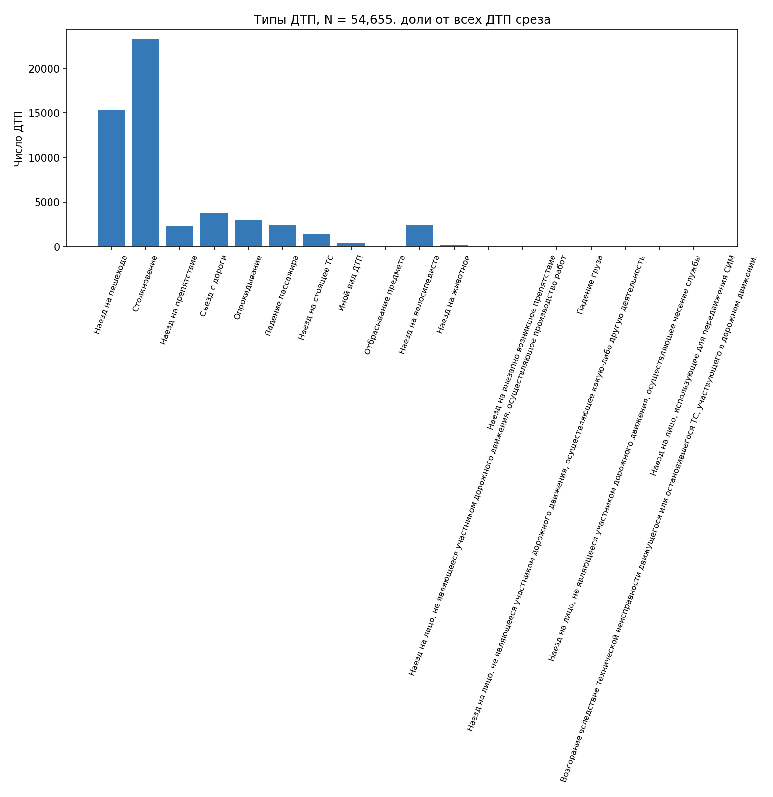
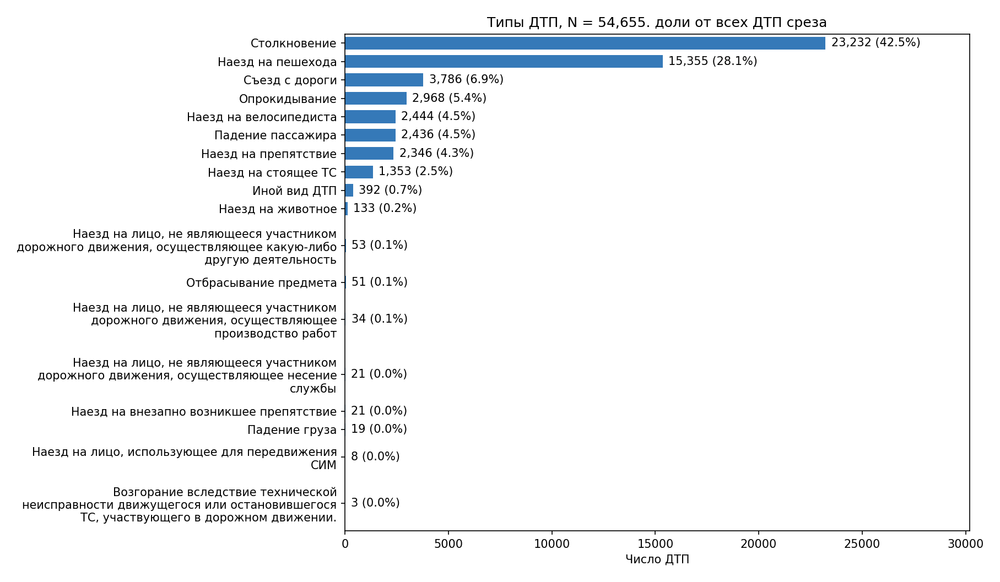

# ДТП в Нижегородской области

saintson1, период с 01.01.2015 по 31.01.2026

## Данные

Я взял данные ["Карты ДТП"](https://dtp-stat.ru/download/). Выгрузку получил через API 03.11.2026. Контрольная сумма файла:

```text
SHA-256: ede26bfdf610f5bb209c33fe136f67653f6a275ca2c6477af7b39a781337cc0c
```

Одним наблюдением я считал одно ДТП. В выгрузке 54 655 событий, повторных ID нет. Я использовал дату, территорию, тип ДТП, освещение, координаты, числа участников, ТС, раненых и погибших. Вложенные списки участников не разворачивал. Последствия определял по счётчикам: "С погибшими" при `dead_count > 0`, иначе "С ранеными" при `injured_count > 0`. Исходной степени "лёгкий/тяжёлый" в API нет.

Я проверил пропуски и значения счётчиков. В датах, категориях и счётчиках пропусков нет. Счётчики неотрицательны, сумма раненых и погибших не превышает число участников. Максимумы, 35 раненых и 40 участников, я сохранил как допустимые значения. За 2026 год есть только 284 январских ДТП. Для гипотез, сезонного сравнения и проекций я оставил 54 371 событие за 2015-2025 годы.

Координаты я проверял по рамке: долгота от 41 до 49, широта от 54 до 59. У 373 записей исходная пара вне рамки, а обратная внутри. Я поменял координаты местами и сохранил оригиналы. Из карт исключил 1100 событий: 697 с `(0, 0)`, 11 без координат, 392 с другими координатами вне рамки. В остальных расчётах их оставил. Рамка приблизительная, точную административную границу я не проверял.

## Исследование

Я собрал дашборд из 12 графиков. Фильтры периода, территории и типа ДТП меняют обзор, исследовательские сравнения и карты. Гипотезы и проекции я рассчитал на фиксированной выборке.

Столкновения составляют 23 232 ДТП (42,51%), наезды на пешеходов составляют 15 355 (28,09%). У 80,22% событий не больше одного раненого, у 93,37% не больше двух. Полный хвост до 35 раненых я сохранил. В 2015 году зарегистрировано 5294 ДТП, в 2025 году 4661. Снижение составило 11,96%, но изменение по годам не монотонно.

После сравнения ночной доли по дням недели я решил проверить, отличаются ли последствия ночных ДТП выходных и будней. Для этого оставил один тип, столкновения, чтобы частично учесть различия состава. Отдельно я сравнил сезонные доли наездов на пешеходов.

## Гипотезы

Ночной интервал я определил с 22:00 до 05:59. Выходные: суббота и воскресенье по дате ДТП. Зима: декабрь, январь и февраль. Лето: июнь, июль и август. Все тесты сделал двусторонними с уровнем значимости 0,05. H1 означает различие величин, указанных в H0. Эффект считал как первую группу минус вторую.

| H0 | Группы и значения | Тест, p-value | Эффект и 95% доверительный интервал |
|---|---|---|---|
| Доли ночных ДТП в выходные и будни равны | Выходные: 2984/15 945 (18,71%). Будни: 4547/38 426 (11,83%) | Перестановочный, 0,0001 | +6,88 п.п., от 6,21 до 7,59 |
| Средние числа раненых в ночных столкновениях равны | Выходные: n=1010, среднее 1,689. Будни: n=1675, среднее 1,616 | Уэлча, 0,174 | +0,074 раненого на ДТП, от -0,028 до 0,181 |
| Доли наездов на пешеходов зимой и летом равны | Зима: 3973/12 020 (33,05%). Лето: 3186/16 006 (19,91%) | Перестановочный, 0,0001 | +13,15 п.п., от 12,11 до 14,22 |

Для перестановочного теста я сделал 9999 перераспределений бинарных исходов с сохранением размеров групп. Статистикой выбрал модуль разности долей. Превышений не было, поэтому `p=(b+1)/(9999+1)=0,0001`. Это минимальная оценка при данном числе повторов. Для средних я выбрал тест Уэлча, поскольку он не требует равных дисперсий. Его применение к счётным данным опирается на большие размеры групп.

Доверительные интервалы я получил через percentile bootstrap разности: 5000 повторов отдельно внутри групп, пересэмплируя целые ДТП. Для трёх проверок зафиксировал seed 42, 43 и 44.

## Карты

Для точечной карты я взял до 5000 случайных событий с seed=42. Для агрегированной карты использовал все 53 555 пригодных координат. Перевёл WGS84 в UTM 38N (EPSG:32638), построил сетку 5 на 5 км и вернул вершины в географические координаты. Подложку взял у [OpenStreetMap contributors](https://www.openstreetmap.org/copyright).

Получилось 2138 заполненных ячеек. В самой заполненной 3548 ДТП (6,62%). Её центр находится около долготы 43,99 и широты 56,32, в центральной части Нижнего Новгорода. В десяти самых заполненных ячейках 35,98% отображаемых ДТП. Это концентрация событий, для оценки риска нужны данные о потоке.

## PCA и t-SNE

Для обеих проекций я взял те же 2500 ДТП за 2015-2025 годы, seed=42. Стандартизировал числа участников и ТС. Тип и освещение закодировал OHE 0/1. Типы с частотой меньше 100 за полный период объединил в "Другие" только для проекций. Получил 18 столбцов. Последствия и координаты в X не включал. Числовых пропусков в подвыборке нет, на случай пропусков я предусмотрел заполнение медианой.

PCA сохранил 53,28% и 14,85% дисперсии по двум компонентам, всего 68,13%. PC1 связана с масштабом события: коэффициент участников +0,649, ТС +0,689, столкновения +0,270. Я проверил исходные признаки по квартильным группам. В нижней группе 73,2% наездов на пешеходов (678/926), в верхней 93,4% столкновений (623/667). Группы больше четверти выборки из-за совпадений на границах.

t-SNE я запустил с perplexity 15 и 40, `init=pca`, `learning_rate=auto`, 1000 итераций, seed=42. При смене параметра меняются расположение и очертания пятен. Среди 2500 событий я нашёл только 218 профилей X. Например, дневной наезд на пешехода с 2 участниками и 1 ТС повторяется 346 раз: 333 с ранеными и 13 с погибшими. Эти повторы объясняют часть плотных групп на обеих проекциях. Площади пятен и расстояния между ними я не трактовал как свойства реальных групп.

## До и после

Я оставил те же 18 категорий и 54 655 ДТП. Заменил вертикальные столбцы горизонтальными, отсортировал их, перенёс длинные названия и добавил число и долю ДТП. Так стало проще сравнивать частоты. Значения и нулевое начало шкалы сохранил.





## Выводы

1. Я обнаружил более высокую долю ночных ДТП в выходные.
2. Я не подтвердил различие среднего числа раненых в ночных столкновениях. Это не доказывает равенство последствий.
3. Я обнаружил более высокую долю наездов на пешеходов зимой.

Дальше я бы проверил, сохраняются ли различия внутри одинаковых лет и территорий. К этому ведут пространственная концентрация и разный состав событий. В проверках я предполагал независимость ДТП и обменность меток при H0. Общие условия могут нарушать эти предположения. Поправку на множественность для трёх исследовательских проверок я не применял. Полнота регистрации неизвестна. Без автомобильного и пешеходного потока я не могу оценить риск поездки или перехода дороги.

## Запуск

```bash
make install
.venv/bin/python data/download_data.py
make analyze
make check
make run
```

Я использовал Python 3.14.4. Зависимости указал в [requirements.txt](requirements.txt), проверенные версии в [requirements-tested.txt](requirements-tested.txt). Числа и параметры сохранил в [results.json](results.json), ход расчётов в [notebook](../notebooks/eda.ipynb). Исходные данные и кеш проекций исключил из Git. При повторной загрузке API нужно сверить SHA-256, снимок может измениться.
